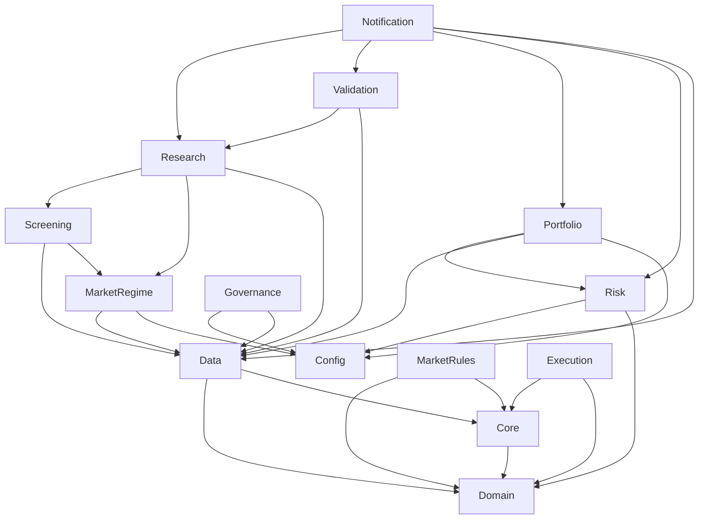

# Project Architecture and Code Audit: 2026-10-15

## Scope and method

Baseline reviewed: `f9e4360` on `codex/wp-launch-001-hardening`, followed by
the fixes described below. Framework `0.8.0`, schema `0.8.2`, migration
`0010_portfolio_evidence_lineage` remain current.

This review inventories the entire source tree with AST analysis and examines
the critical Data, Screening, Research, Investment, Validation/Replay,
Portfolio, Risk, Notification, configuration, persistence, and disabled
execution contracts. It is a static inventory plus targeted code review and
regression verification, not a claim that every provider endpoint or every
source line received independent external verification. No live provider or
broker entitlement was tested during this audit.

- 188 source Python files, including reserved packages; 12 operational scripts.
- No duplicate source class names were found by AST inventory.
- Top-level static import-cycle tests pass, including type-only dependencies.
- A fresh, fully migrated temporary database has 64 non-internal tables and
  no foreign-key violations. The baseline `SCHEMA` alone contains 45 tables;
  it is not the current database inventory.
- The 5,348-line pre-fix SQLiteStore is the largest ownership hotspot.
- The August current-state report is now explicitly marked as a historical
  freeze and linked to current governance to prevent conflicting authority.

## Findings and disposition

| ID | Priority | Evidence and consequence | Disposition |
|---|---|---|---|
| A-01 | P0 | `portfolio/construction.py` discarded candidate sector/country/theme and substituted instrument industry, listing market, and holding role. Concentration and risk-budget checks could group the wrong exposures. | Fixed. Generic RiskPositionInput and portfolio summaries use the explicit candidate classifications. Regression tests deliberately disagree with instrument industry and holding role. Classification provenance still needs future verification. |
| A-02 | P0 | `get_verified_proposal` reconstructed records and checked lineage through separate connections. A concurrent writer could change the evidence between reads. | Fixed for this boundary. Reconstruction and verification share one read snapshot; a concurrent-update test verifies isolation and the next read sees the changed record. Later consumption must still bind exact artifact content. |
| A-03 | P0 | `upsert_daily_bars` and `upsert_trading_sessions` silently replaced a historical version at the same PIT key. Previous replay inputs could change after ingestion. | Fixed. Identical content is idempotent; changed values or source require a new available_at version. Conflict tests check rollback and old/new as-of visibility. Existing overwritten history cannot be recovered by this patch. |
| A-04 | P1 | Risk's default maximum drawdown was 20%, while project configuration declared 15%; direct configuration objects had no validation, and the engines had no shared settings constructor. | Fixed current defaults and added validated settings factories for both engines. Overrides must enter through PortfolioProposalEngine.from_settings. The future application boundary must require this path. |
| A-05 | P1 | Risk accepted duplicate position identities or unnormalized weights. A zero permitted liquidity threshold caused division by zero; stress loss could contain NaN/infinity. An ACCEPTABLE assessment could carry unresolved adjustments or breached exposures. | Fixed with input and model invariants; zero liquidity threshold now explicitly disables that filter. |
| A-06 | P1 | Notification acknowledgement matched notification ID and dispatching state only. An old worker could mark a newly reclaimed attempt successful or failed. | Fixed by matching the current attempt, channel, and recipient. Tests retain the current claim and allow only its completion. External duplicate sends after crashes remain possible. |
| A-07 | P0 | Market helpers reject unsupported queries, but no effective-dated rule catalog or pilot evaluator exists. | Capability declarations and an inspector are now implemented. Missing, future, expired, untrusted, or overlapping evidence stays visible. The real catalog remains empty and evaluators remain absent. |
| A-08 | P0 | Historical lifecycle, universe, fundamentals/publication and corporate-action evidence remains insufficient. The provider monitor's calibration ledgers are empty. | Open: R-001/R-015/R-026, TD-021/TD-025/TD-028. No readiness promotion. Health probes and synthetic fixtures cannot prove real provider consistency. |
| A-09 | P0 | Portfolio evidence checks are structural; they are not yet bound to a persisted simulation decision with independently checked PIT, risk and market-rule content hashes. The live readiness context still accepts caller declarations. | Open: R-028/R-031, TD-027/TD-029. Keep live disabled and complete the simulation boundary before the paper ledger. |
| A-10 | P1 | Risk uses weighted volatility, weighted scalar correlation, and maximum single-position weighted volatility times two as a drawdown proxy. Candidate max_drawdown is not consumed, and scenario target is not applied. | Open: TD-031. These are research heuristics, not calibrated portfolio risk or enforceable maximum drawdown. Define estimands, missing-data handling, covariance, FX and scenario scope before treating risk as simulation eligibility. |
| A-11 | P1 | Same-version instrument upserts can modify security-master fields. Cache writes are not atomic and malformed files propagate errors. | Open: TD-032/TD-034. Add security-master correction provenance and conflict policy, then atomic cache publication with corrupt-entry recovery. Immutable bar/calendar behavior does not solve these separate paths. |
| A-12 | P1 | SQLiteStore centralizes many unrelated domains in one large file. | Open: TD-033. Split domain query/writer ownership gradually while preserving one transaction manager and the existing schema fingerprints. A broad rewrite would add avoidable migration risk. |

## Changes and compatibility

Portfolio and Risk model versions advance to `portfolio-proposal-v0.7.1` and
`risk-assessment-v0.7.1`. Their defaults live in `version.py`; governance checks
the default TOML against those values. Existing research artifacts retain
their original versions and are not recalculated or relabelled. A current
evidence policy rejects a mismatched legacy model version.

The new factories configure Portfolio and Risk from one effective Settings
object. Risk remains independent of Portfolio model classes. Direct
constructors remain available for explicit tests and research experiments;
their existence is not application-level enforcement.

Multi-query portfolio reads use `SQLiteStore.read_snapshot()`. New independent
snapshots reject writes. Reads within an existing transaction share that
transaction. The snapshot protects one reconstruction only; a future consumer
must persist the selected content hashes and recheck them when necessary.

There is no DDL change, schema rewrite, new migration, or live database
modification. Fresh initialization, migration convergence, and recovery tests
remain part of the full test suite.

## Dependency structure

Arrows below indicate Python dependencies, not capital or trade flows.

Research owning the queue-consumer dependency on Screening is deliberate.
Portfolio verifies Research/Validation through persisted evidence without
importing execution. Notification consumes only the four approved artifact
types. Universal Signals do not replace InvestmentScore or validation lineage.
Layering tests now explicitly prohibit Risk importing Portfolio and upstream
engines importing Execution.

## Next work and readiness

`WP-LAUNCH-001` remains ready/in progress; it is not complete. The next bounded
step is a reviewed pilot-market rule evidence reader plus dated evaluators for
calendar, quantity, sellability, price limits and status. Evidence must be scoped
to market, exchange, board and account. The inventory uses inclusive starts
and exclusive ends; overlapping applicable versions are ambiguous rather than
implicitly selecting the latest one.
Trust and availability precision are separate. Unknown, estimated, and
date-only visibility is insufficient under this contract; retrieval-time
evidence stays bounded by its capture timestamp and retains a warning.

After real evidence and fixtures exist, bind the exact proposal, validation,
risk, policy, dataset readiness and market-rule hashes at one simulation
boundary. A capability coverage pass alone cannot authorize a fill. Review and
pin the actual Validation configuration hash; the default remains empty.

Only then can `WP-PAPER-001` become ready for its persistent deterministic
ledger, cost/fill model, restart recovery and reconciliation. Provider evidence
accumulation runs in parallel. The existing 84-day requirement governs its own
historical-evidence claims; it does not stop controlled engineering.

| Area | Current assessment |
|---|---|
| Architecture and automated checks | Maintained research foundation; known debt recorded |
| Research | Conditional on actual input completeness and trust |
| Historical validation | Mechanically available; evidence blocked |
| Portfolio/Risk | Explainable research artifacts; empirical risk calibration outstanding |
| Market rules | Evidence coverage contract available; real catalog/evaluators missing |
| Paper Trading | Planned behind launch package |
| Production/live | NOT_READY; execution disabled |
| PIT | UNSUITABLE; no promotion from this audit |

## Verification

Required completion checks: full Pytest, Ruff, mypy across source and scripts,
git diff checks and governance audit. New regressions cover exposure routing,
configuration overrides, invalid risk inputs, conflicting risk status,
read-snapshot concurrency, stale notification workers, immutable market-data
versions and market-rule capability timing/scope/ambiguity/hash behavior.
Final counts and the commit are recorded in the completion report.

Final local verification: 363 passed, 6 skipped; Ruff passed; mypy passed for
200 source/script files; governance and git diff checks passed. Optional
network integration tests remain disabled under their normal defaults. These
results do not verify actual exchange rules or live broker behavior.
