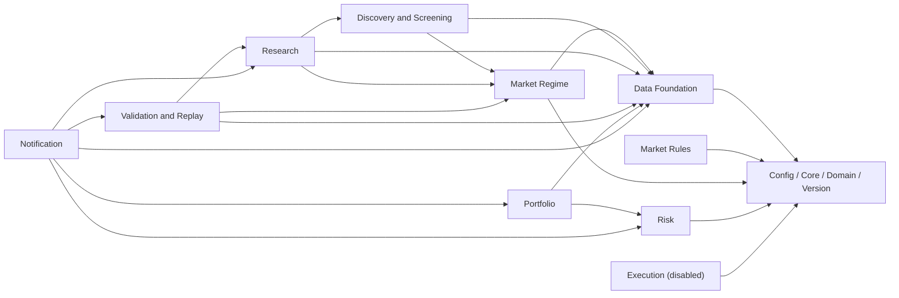

# Tong Quant Current State Report

## Baseline Freeze

This document is the project-wide architecture and readiness baseline for Tong
Quant V0.1 through V0.8. It records the system as it exists before any new
feature development.

| Item | Frozen value |
|---|---|
| Review date | 2026-08-22 |
| Code baseline | Current Git HEAD; exact published commit is reported with each release |
| Remote baseline | Revalidated after each requested push with `git ls-remote` |
| Framework version | `0.8.0` |
| Public database schema version | `0.8.0` |
| Migration head | `0008_provider_calibration_attempts` |
| Latest data evidence | Phase III reports; live CNInfo/Yahoo contract probes; bounded direct CNInfo metadata/PDF checks; deterministic Yahoo/independent daily-bar calibration; owner-assigned provider-health operations |
| Scope boundary | Research platform only; no live trading capability |

Provider-neutral evidence, engineering continuity governance, and longitudinal
provider baseline infrastructure are part of the current architecture. Phase
III reports remain evidence snapshots; they are not silently reinterpreted as
new readiness conclusions.

`WP-READINESS-001` adds a deterministic evidence reassessment boundary. It
inventories immutable report hashes and optional operational SQLite history,
distinguishes missing evidence from observed quality failure and provider
restriction, and emits proposed classifications for human review. Effective
classifications remain unchanged by construction.

## Executive Assessment

Tong Quant is a well-structured personal investment research platform with
strong point-in-time contracts, explainable artifacts, deterministic replay,
layering tests, fail-closed execution controls, and a hardened notification
outbox. Its software architecture is materially more mature than its historical
data evidence.

The decisive constraint is data readiness. The current Phase III dashboard
classifies every audited framework data area as `UNSUITABLE` for reliable
Historical Replay. Tushare is implemented and authenticated but current
account-tier permissions do not expose the required calibration datasets; the
AKShare index-constituent queries also failed in the latest Phase III run.
The framework must therefore remain a research and data-engineering platform;
historical performance claims, Paper Trading conclusions, and capital use are
not justified by the current evidence.

| Capability | Assessment | Meaning |
|---|---|---|
| Architecture | Strong prototype | Clear boundaries, no static package cycles, tested invariants |
| Production | Not ready | Missing operational controls and reliable historical data |
| Research | Conditional | Suitable for forward/current research with explicit warnings |
| Historical validation | Not ready | Replay machinery exists; PIT inputs remain unsuitable |
| Portfolio | Research-artifact ready | Proposal and risk models exist; not capital allocation authority |
| Notification | Hardened disabled baseline | Preview/fake delivery is testable; live operations are not proven |
| Execution | Disabled | Fail-closed skeleton only; no approved execution capability |

## 1. Current Architecture Map

The canonical workflow remains:

```text
Providers and raw evidence
          |
Validation -> Normalization -> PIT-safe persistence -> Data trust/readiness
                                                       |
Discovery -> Hard Screening -> Research Queue -> Research Report
                                                       |
Investment Assessment + Investment Score -> Validation + Historical Replay
                                                       |
Portfolio Proposal -> Risk Assessment -> Notification Outbox
                                                       |
                                               Deferred delivery

Execution remains disabled and outside this workflow.
```

### Module Ownership

| Module | Current responsibility | Explicit boundary |
|---|---|---|
| `domain` | Shared instruments, Signals, market enums, risk decisions | Contains no provider or persistence code |
| `core` | Cross-cutting exceptions and small shared contracts | Must not own business workflows |
| `config` | Typed settings and fail-closed defaults | Credentials remain environment-only |
| `markets` | Shared market rules plus China A, US, Hong Kong, Malaysia reservations | Funds are extension scaffolding only |
| `data` | Provider adapters, normalization, quality, calibration, provider health, cache, SQLite, PIT reads | Operations reports do not use Notification or trading modules |
| `discovery` | Opportunity discovery boundary | Does not rank the entire market into trades |
| `screening` | Hard screening, seven dimensions, watchlist, Research Queue | Does not own research outcomes |
| `market_regime` | Bull, Sideways, Bear and transition research states | Weighted variable, not a hard trading switch |
| `research` | Value, financial, technical, trend, pattern, industry, policy research | Produces falsifiable reports, not orders |
| `validation` | Historical, walk-forward, OOS, thesis, factor, accuracy, journal, replay | Audits research quality; no fills or execution |
| `risk` | Generic position-risk evaluation and stress scenarios | Does not depend on Portfolio models |
| `portfolio` | Proposal-only construction from InvestmentScore and validation evidence | Not a recommendation or rebalance instruction |
| `notifications` | Research-artifact rendering, outbox, dispatch, dead letters | Consumes only four approved artifact types |
| `execution` | Disabled guard and readiness skeleton | No usable broker, Paper Trading, or live path |
| `strategies`, `ai`, `events` | Reserved boundaries | No production strategy or autonomous decision logic |

### Core Contract Flow

```text
OpportunityCandidate
  -> ScreeningResult / ResearchQueueEntry
  -> ResearchReport
  -> InvestmentAssessment + InvestmentScore
  -> ValidationReport / ReplayValidationSample
  -> PortfolioProposal
  -> RiskAssessment
  -> NotificationMessage
```

`Signal` remains a universal explainable artifact, not an Order. Notification
does not consume Signal directly. Execution is the only reserved location that
could create or submit an Order, and its guards currently reject readiness.

## 2. Module Dependency Graph



Static imports across 180 source files show no top-level package cycle. The
important directional properties are intact:

- Risk does not import Portfolio; Portfolio imports the generic Risk contract.
- Validation has no Execution or Order dependency.
- Notification has no Signal, Execution, Broker, Order, Trade, Fill, or Paper
  Trading dependency.
- Screening does not own `ResearchReport`, `InvestmentAssessment`, or
  `InvestmentScore`.
- Execution is isolated; no upstream workflow imports it.

The main coupling watchpoint is Notification's deliberate fan-in to four
concrete upstream artifact models. This is acceptable at V0.8, but stable
read-only artifact contracts should be introduced before those models begin
changing independently or are moved to separate services.

## 3. Database Schema Inventory

The initialized SQLite schema contains 63 application tables, excluding SQLite
internal tables.

### Metadata and Migrations (3)

`schema_metadata`, `schema_migrations`, `schema_fingerprints`

### Data Foundation and Calibration (19)

`instruments`, `daily_bars`, `trading_calendar`, `fundamental_facts`,
`instrument_status_history`, `universe_memberships`, `corporate_actions`,
`ingestion_batches`, `raw_dataset_fingerprints`,
`data_availability_warnings`, `provider_limitations`,
`pit_readiness_assessments`, `security_lifecycle_events`,
`fundamental_publication_events`, `historical_coverage_assessments`,
`provider_consistency_reports`, `provider_conflicts`,
`dataset_confidence_assessments`, `provider_calibration_attempts`

### Provider Evidence and Monitoring (8)

`provider_evidence_records`, `provider_artifacts`,
`provider_artifact_observations`, `provider_contract_runs`,
`provider_contract_checks`, `provider_baseline_manifests`,
`provider_baseline_entries`, `provider_baseline_inputs`

### Historical Replay (2)

`historical_replay_manifests`, `historical_replay_samples`

### Signals and Screening (4)

`signals`, `screening_results`, `research_queue`, `screening_scorecards`

### Research and Investment Assessment (6)

`research_runs`, `research_evidence`, `research_assessments`,
`research_reports`, `investment_assessments`, `investment_scores`

### Validation (13)

`validation_runs`, `validation_oos_usage`, `validation_splits`,
`validation_observations`, `validation_outcomes`,
`validation_outcome_definitions`, `decision_journal`,
`validation_assessments`, `validation_reports`,
`validation_factor_contributions`, `validation_accuracy_history`,
`validation_integrity_checks`, `validation_portfolio_risk`

### Portfolio and Risk (5)

`portfolio_proposals`, `position_proposals`, `risk_assessments`,
`portfolio_exposures`, `portfolio_constraints`

### Notification (3)

`notification_outbox`, `notification_deliveries`,
`notification_dead_letters`

### Schema Engineering Status

- Public schema version: `0.8.0`.
- Migration head: `0008_provider_calibration_attempts`.
- Migrations are ordered and checksum-verified.
- Research and Validation final writes have transaction boundaries.
- A fresh schema passes `PRAGMA foreign_key_check`.
- Notification hardening, provider evidence, and provider baseline tables have
  explicit foreign keys. Most older analytical ownership relationships remain
  enforced in repositories and tests rather than by SQLite.
- Read-only audits, SQLite online backups, and isolated no-overwrite restore
  drills verify integrity, foreign keys, migration checksums, fingerprints, and
  table counts.
- Migrations remain forward-only; downgrade, free-space checks, automated
  encrypted retention, and broad post-migration domain invariants are incomplete.
- `data/storage/sqlite.py` is 5,180 lines and is the largest maintainability
  hotspot.

## 4. Provider Inventory

| Provider | Market / role | Implementation status | Current evidence | Intended use |
|---|---|---|---|---|
| AKShare `1.18.64` | China A primary adapter | Active | Latest Phase III audit completed | Bars, calendar, company data, lifecycle, disclosure, universe, actions |
| Tencent via AKShare | China bar fallback | Active fallback | Used only when primary history endpoint fails | Unadjusted daily-bar continuity |
| Tushare | China A optional calibration | Engineering complete and frozen | Token validated; account-tier limits prevent fully available calibration datasets | Optional cross-provider evidence when permissions allow |
| CNInfo via AKShare | China A disclosure evidence | Provider-neutral adapter implemented | Fake-client and live contract checks | Transported announcement timestamps with explicit provenance |
| CNInfo direct | China A disclosure metadata/artifacts | Direct adapter and content-addressed store implemented | Real bounded metadata, one-PDF, and 3/3 same-day transport-parity smoke checks; representative continuity unverified | Official timestamp, URL, relation and content-hash evidence |
| Yahoo Finance | Overseas bootstrap | Provider-neutral adapter implemented | Fake-client contract tests; live continuity unverified | Low-trust retrieval-time US/HK/Malaysia bars |
| Massive/Polygon | Optional US calibration provider | Provider-neutral unadjusted bar/action adapter implemented | Fake-client and security tests; no committed real provider evidence | Independent Yahoo comparison when credentials and permissions allow |
| Finnhub | Overseas news/fundamental provider | Future reservation only | No adapter or capability study | News, filings, fundamentals, event augmentation |
| Telegram / WeChat / Email | Notification delivery channels | Implemented and disabled by default | Fake-channel tests; live tests opt-in and skipped | Research information only |
| QMT / PTrade / IBKR / Moomoo | Broker/execution providers | Not implemented | No connectivity | Explicitly outside current readiness |

AKShare and Tushare are a sensible China-market pairing, but adapter diversity
does not automatically mean source independence: both may ultimately reproduce
the same exchange or portal records. Calibration must preserve raw provenance
and identify common upstream sources. Yahoo Finance is reasonable for an
overseas research bootstrap, but it should not be treated as the final source
for exchange-grade PIT fundamentals, corporate actions, or production service
levels. Massive is now an optional low-trust calibration source, not an
authority. Finnhub should be introduced only after endpoint, licensing,
timestamp, revision, and identifier coverage are measured.

## 5. PIT Readiness Inventory

The latest runtime assessment is `UNSUITABLE` overall. Record counts describe
the observed response, not historical coverage.

| Dataset | Primary rows | Trust | Availability precision | Continuity | Current PIT | Best-case ceiling after perfect dual validation |
|---|---:|---|---|---:|---|---|
| Security lifecycle | 1,693 | MEDIUM | Retrieval time | 35 | UNSUITABLE | CAUTION |
| ST status | 1,464 | MEDIUM | Retrieval time | 50 | UNSUITABLE | CAUTION |
| Suspension status | 25 | MEDIUM | Retrieval time | 20 | UNSUITABLE | CAUTION |
| Delisting records | 204 | MEDIUM | Retrieval time | 55 | UNSUITABLE | CAUTION |
| Financial publication dates | 5,189 | MEDIUM | Date only | 70 | UNSUITABLE | USABLE |
| Fundamental revisions | 23 | HIGH | Exact | 55 | UNSUITABLE | USABLE |
| Corporate actions | 25 | MEDIUM | Retrieval time | 55 | UNSUITABLE | CAUTION |
| Market-wide universe | 5,528 | LOW | Retrieval time | 25 | UNSUITABLE | CAUTION |
| CSI300 membership | 0 | UNKNOWN | Unknown | 0 | UNSUITABLE | UNSUITABLE |
| CSI500 membership | 0 | UNKNOWN | Unknown | 0 | UNSUITABLE | UNSUITABLE |
| CSI1000 membership | 0 | UNKNOWN | Unknown | 0 | UNSUITABLE | UNSUITABLE |

All seven framework areas are currently `UNSUITABLE`: Fundamentals, Security
Lifecycle, Universe Membership, Corporate Actions, Market Regime Inputs,
Research Inputs, and Validation Inputs. Historical Replay reliability is `NO`;
future Paper Trading research reliability is also `NO`.

The latest AKShare normalized responses were internally complete for the eight
successful datasets, but this must not be described as historical coverage.
The three CSI constituent queries failed after bounded retries with `URLError`.

## 6. Data Trust Inventory

No integrated AKShare dataset is universally PIT-safe.

| Data class | Trust / classification | Permitted use |
|---|---|---|
| Unadjusted A-share and China index daily bars | MEDIUM, partially reliable | Historical price research with explicit close-time and correction assumptions |
| Adjusted A-share bars | LOW, unsuitable | Rejected in strict PIT mode until dated factors are reconstructable |
| Trading calendar | MEDIUM, partially reliable | Operational calendar with closure/correction caveats |
| Company information | LOW, retrieval snapshot | From stored retrieval time only |
| Current A-share universe | LOW, retrieval snapshot | Forward snapshot collection only |
| Statements without publication evidence | LOW, retrieval snapshot | Not valid before ingestion time |
| Actual disclosure schedule | MEDIUM, date-only | Conservative end-of-day availability |
| CNInfo financial announcements | HIGH per covered record | Exact timestamp evidence with coverage and parsing warnings |
| Direct CNInfo filing evidence | MEDIUM, exact timestamp | Official metadata and content hashes; continuity and representative parity remain unverified |
| Current ST and suspension lists | LOW, retrieval snapshot | Current/forward evidence only |
| Suspension and Shenzhen name-change events | MEDIUM, partial | Preserve dated evidence; never infer missing intervals |
| Delisting records | MEDIUM, partial | Terminal-event evidence, not complete warning history |
| CSI constituents | LOW-MEDIUM snapshot; currently unavailable | No backward survivorship-safe reconstruction |
| Corporate actions | MEDIUM content, LOW timing | Audit evidence; not PIT adjustment authority |
| Yahoo/Massive unadjusted daily bars | LOW, retrieval-time | Provider comparison and exploratory research only; fixture agreement is not real coverage |

`DataTrustLevel` and `AvailabilityPrecision` remain separate. Research,
Validation, and Replay must preserve both together with provider limitations,
missing-data warnings, hashes, and readiness assessments. Missing or low-trust
samples remain visible instead of being silently dropped.

## 7. Technical Debt Inventory

| ID | Priority | Debt | Current control | Exit condition |
|---|---|---|---|---|
| TD-001 | P0 | Complete PIT publication, lifecycle, and universe history is unavailable | Conservative trust and warnings | Verified historical coverage and reconciliation |
| TD-002 | P0 | Corporate-action timing and dated adjustment factors are incomplete | Strict PIT rejects adjusted bars | Reproducible PIT factor ledger |
| TD-003 | P0 | No representative real secondary-provider consistency baseline | Tushare absence and optional Massive access remain explicit; fixture agreement cannot promote trust | Date-aligned real dual-provider runs across multiple periods |
| TD-004 | P1 | Most analytical tables lack database foreign keys | Repository contracts and tests | Orphan audit plus staged FK migrations |
| TD-005 | P1 | SQLite storage remains a large ownership monolith | Module-facing repository contracts | Split by domain behind one transaction manager |
| TD-006 | P1 | Recovery scheduling, encrypted off-device retention, downgrade, free-space checks, and broad migration invariants remain incomplete | Verified online backup, isolated restore, checksums, fingerprints, row counts, and runbook | Recurring encrypted recovery exercises plus staged domain-invariant checks |
| TD-007 | P1 | Runtime framework snapshots are partly caller-supplied | Stored hashes and versions | Runtime factory verifies Git state and effective config |
| TD-008 | P1 | Notification lacks worker supervision, alerting, replay policy, and retention policy | Lease recovery and dead letters | Operational runbook and monitoring |
| TD-009 | P1 | At-least-once notification can duplicate an externally accepted send | Dedup key and lease recovery | Provider idempotency/reconciliation support |
| TD-010 | P1 | Generated live reports change timestamps and query dates, producing worktree churn | Generated reports are reviewable evidence | Reproducible run manifest and explicit evidence snapshot policy |
| TD-011 | P2 | Notification directly imports four concrete artifact models | Layer tests constrain fan-in | Stable read-only notification artifact contracts |
| TD-012 | P2 | Portfolio and Risk are explainable heuristics, not calibrated models | Proposal-only semantics | Validation against reliable samples and tail/liquidity evidence |
| TD-013 | P2 | Live provider tests are skipped by default | Deterministic fakes plus twice-weekly isolated provider monitoring and health escalation | Accumulate and review a representative observation horizon |
| TD-014 | P2 | No enforced coverage threshold or PIT property-test suite | CI runs tests, Ruff, mypy | Coverage policy and time-ordering properties |
| TD-015 | P2 | Overseas identifier and reference normalization remains incomplete | Yahoo/Massive share session, OHLCV, price-basis, and action-date contracts | Tested exchange, identifier-history, currency, calendar, and delisting mappings |

No trading-strategy implementation is listed as technical debt. Its absence is
an intentional safety and sequencing decision.

## 8. Risk Register

| ID | Severity | Risk | Current mitigation | Residual action |
|---|---|---|---|---|
| R-001 | Critical | Survivorship or future leakage creates false historical results | `available_at`, strict replay, warnings, adjusted-bar rejection | Complete historical universe and event evidence |
| R-002 | Critical | A single effective upstream source creates false confidence | Provider abstraction and conflict registry | Measure true source independence and consistency |
| R-003 | Critical | Historical results are treated as reliable despite `UNSUITABLE` inputs | Readiness dashboard and replay confidence | Hard governance gate on published validation claims |
| R-004 | Critical | Future execution bypasses validation or risk | Execution disabled, guarded, and isolated | Full re-audit before any Paper/Execution milestone |
| R-005 | High | Fundamental values are paired with optimistic publication times | Separate availability precision and announcement evidence | Backfill publication/revision ledgers |
| R-006 | High | Corporate actions contaminate historical prices | Adjusted histories rejected in strict mode | Dated adjustment-factor reconstruction |
| R-007 | High | CSI/universe endpoint failure blocks market breadth and membership research | Bounded retries and visible failure | Stable primary plus independent secondary source |
| R-008 | High | Orphaned rows or partial migrations corrupt analytical reconstruction | Transactions, checksums, verified backups/restores, fingerprints, limited FKs | Orphan audit, staged FK program, recurring recovery drill |
| R-009 | High | Portfolio heuristics are mistaken for investment authority | Proposal naming, status, disclaimers, no orders | Human governance and calibrated validation |
| R-010 | High | Notification crash or retry duplicates external delivery | Leases, deterministic dedup, dead letter | Provider acknowledgement reconciliation |
| R-011 | High | Credentials enter persistent content | Environment-only values and repository-level rejection | Access controls and secret scanning remain required |
| R-012 | Medium | AKShare endpoint or column drift silently changes data | Schema checks, hashes, fakes, quality audit, scheduled live monitor, repeated-condition escalation, and defect-only CI failure | Representative history and approved service-level thresholds |
| R-013 | Medium | Dirty generated evidence is mistaken for a clean release | Baseline records both commit and runtime evidence | Commit reviewed evidence or exclude it before tagging |
| R-014 | Medium | SQLite becomes a scaling and maintenance bottleneck | Single-user scope and transaction manager | Split ownership first; benchmark before changing database |
| R-015 | Medium | Overseas free-source data is over-trusted | Yahoo evidence defaults to LOW/retrieval-time and contract checks do not upgrade it | Calibrate Yahoo against independent providers before claims |

## 9. Known Limitations

- Security lifecycle evidence is incomplete; national ST, suspension, warning,
  delisting-period, and relisting timelines cannot be reconstructed fully.
- Current universe and index constituents are snapshots, so backward tests are
  exposed to survivorship bias.
- AKShare index membership was unavailable in the latest audit.
- Tushare authentication works, but current account-tier permissions block the
  required datasets; cross-provider coverage and consistency remain unmeasured.
- Fundamental announcements improve timing evidence but do not always provide
  every prior numeric revision.
- Corporate-action timing and adjustment-factor history are not reliable enough
  for strict PIT-adjusted prices.
- Market bars and outcome labels still require a dedicated historical trust
  audit for validation use.
- News, policy, sentiment, industry heat, and macro datasets are architectural
  modules rather than calibrated historical evidence pipelines.
- Yahoo supplies research-grade US, Hong Kong, and Malaysia bars, but these
  markets still lack authoritative lifecycle, universe, calendar, correction,
  and delisting evidence.
- MarketRules models only a conservative subset of A-share settlement, limits,
  sessions, board-specific rules, and fees.
- SQLite remains appropriate for a personal single-writer research platform,
  not a concurrent production service without further engineering.
- Notification live-network behavior, worker supervision, monitoring, and
  incident procedures are not production-proven.
- There is no Paper Trading ledger, broker integration, live execution, asset
  allocation, portfolio optimization, or automatic order generation.

## 10. Production Readiness Assessment

**Classification: NOT READY.**

Positive controls include strict typing, CI, deterministic tests, migration
checksums, transaction boundaries, environment-only credentials, credential
persistence rejection, notification leases/dead letters, and fail-closed
execution. These are necessary but not sufficient.

Production readiness is blocked by `UNSUITABLE` PIT data, lack of verified
secondary-provider evidence, manual backup scheduling/off-device retention,
and unproven provider service levels. Provider-monitor ownership and recovery
procedures now exist, but their observation horizon is not representative.
Execution must remain disabled. The current system should not manage capital or
publish broad historical performance claims.

Exit gate: critical research datasets reach at least `CAUTION` with verified
provider consistency, database backup/restore and migration checks are tested,
and operational ownership is documented.

## 11. Research Readiness Assessment

**Classification: CONDITIONAL / FORWARD-RESEARCH READY.**

The system can support manually reviewed, current-time and forward-collected
equity research where every report carries trust, availability, completeness,
and provider warnings. Its thesis/counter-thesis, invalidation, evidence, and
assessment-status contracts are sound.

It is not ready for survivorship-safe broad-market historical conclusions.
Research using retrieval snapshots must begin no earlier than the stored
`available_at`; absence from a partial dataset cannot be interpreted as absence
from the market.

Exit gate: the specific datasets required by a research question, not merely an
overall average, meet documented readiness thresholds and have reproducible
raw evidence.

## 12. Validation Readiness Assessment

**Classification: ARCHITECTURALLY READY, EVIDENCE BLOCKED.**

Historical, walk-forward, out-of-sample, market-regime, thesis, factor,
research-accuracy, decision-journal, and portfolio-risk validation contracts
exist. Replay separates decision and outcome context, retains incomplete
samples, generates deterministic hashes, and stores framework snapshots and
ReplayConfidence.

The validation engine cannot make historical reliability stronger than its
inputs. Current samples should be treated as diagnostics, not evidence of
strategy or framework effectiveness.

Exit gate: required replay datasets reach at least `CAUTION`, outcome labels
receive their own PIT audit, and representative end-to-end samples pass leakage
and continuity review.

## 13. Portfolio Readiness Assessment

**Classification: RESEARCH-ARTIFACT READY; CAPITAL USE NOT READY.**

Portfolio consumes InvestmentScore only after Research and Validation. It can
produce `PortfolioProposal`, `PositionProposal`, exposure, constraint, risk
budget, volatility, liquidity, concentration, correlation, drawdown, and simple
scenario-stress artifacts. Risk remains decoupled through generic position
inputs.

The calculations are explainable heuristics. They are not calibrated portfolio
optimization, recommendations, rebalance instructions, or execution inputs.

Exit gate: reliable validated samples, covariance/liquidity/cost evidence,
model-risk review, and explicit human governance. No automatic downstream path
should be added at this stage.

## 14. Notification Readiness Assessment

**Classification: HARDENED DISABLED BASELINE.**

Notification consumes only `ResearchReport`, `ValidationReport`,
`PortfolioProposal`, and `RiskAssessment`. It renders the mandatory research
disclaimer, persists through an idempotent SQLite outbox, recovers expired
leases, dead-letters permanent failures, rejects credential-like persistence,
and separates generation from delivery. Global mode defaults to `disabled`;
fake-channel integration is tested and live tests are opt-in.

Preview and local testing are ready. Enabled production delivery is not ready
until worker supervision, alerts, dead-letter operations, retention, provider
idempotency/reconciliation, and sandboxed live-channel verification exist.

## 15. Recommended 12-Month Roadmap

This roadmap is gate-driven. Calendar time alone must not authorize the next
phase.

### Months 0-3: Preserve and Extend Evidence

- Freeze the current report and decide how generated live evidence is versioned.
- Continue scheduled AKShare forward snapshots for universe, ST, suspension,
  lifecycle, disclosure, and constituent history.
- Add run manifests that separate query date, retrieval date, code commit,
  environment, and raw hashes without making reports falsely deterministic.
- Resolve CSI endpoint reliability with a documented fallback source.
- Schedule recurring database restore drills, encrypted off-device rotation,
  and orphan audits.
- Split SQLite ownership incrementally without changing domain behavior.
- Keep Tushare `UNKNOWN` until registration and permissions are available; do
  not block AKShare continuity work while waiting.

Gate A: repeatable AKShare evidence collection, clean migration/backup checks,
and no regression in strict PIT handling.

### Months 3-6: Real China Cross-Provider Calibration

- Validate Tushare environment and endpoint permissions when available, or
  select another qualified secondary source if access remains blocked.
- Run date-aligned comparisons across multiple periods for lifecycle,
  disclosure, revisions, actions, universe, and CSI membership.
- Persist conflicts, source lineage, completeness, continuity, and confidence.
- Backfill only evidence that has defensible publication/effective timestamps.
- Audit market bars and validation outcome labels explicitly.

Gate B: critical Historical Replay datasets reach at least `CAUTION` with
observed provider consistency; no critical unresolved conflict is hidden by an
aggregate score.

### Months 6-9: Overseas Research Data Foundation

- Define canonical identifier mapping across ticker, exchange, currency,
  timezone, and corporate-action identities.
- Calibrate the implemented Yahoo read-only bootstrap for US, Hong Kong, and
  Malaysia; document licensing, corrections, adjustment, and timestamp limits.
- Build the same capability, trust, coverage, and conflict reports before
  calling any overseas dataset historical.
- Evaluate Massive/Polygon and Finnhub by dataset role rather than treating
  either as a universal replacement.
- Keep overseas workflows research-only and do not share A-share policy rules.

Gate C: at least one overseas market has reproducible unadjusted prices,
calendar, instrument lifecycle, and universe evidence with explicit trust.

### Months 9-12: Validation Calibration and Design Review

- Rebuild representative replay samples from verified provider evidence.
- Calibrate ResearchConfidence, ReplayConfidence, InvestmentAssessmentStatus,
  and portfolio-risk limitations against reviewed cases.
- Add PIT property tests, coverage thresholds, reviewed provider service-level
  thresholds, and runtime-derived framework snapshots.
- Operationalize Notification in preview only if dead-letter and worker
  procedures pass drills.
- Conduct a Paper Trading architecture review only if Gates A-C pass. A review
  is not approval to implement Paper Trading, Execution, Broker, Orders, Fills,
  Auto Rebalancing, or Live Trading.

Gate D: project review explicitly confirms whether data and validation evidence
justify a separate future milestone. Without that approval, continue data
remediation.

## Project Inventory

| Metric | Current value | Counting rule |
|---|---:|---|
| Source files | 181 | Python files under `src/` |
| Source lines | 30,662 | Python lines under `src/`, including blanks/comments |
| Test files | 45 | Python test modules under `tests/` |
| Test cases | 240 | Pytest collection |
| Test lines | 9,248 | Python lines under `tests/` |
| Database tables | 63 | Initialized application tables, excluding SQLite internals |
| Documentation files | 48 | Markdown files under `docs/` |
| Runtime scripts | 8 | Files under `scripts/` |
| Static top-level dependency cycles | 0 | Package import audit |

The verification baseline is 234 passed and 6 skipped tests. Skips are the
expected opt-in live AKShare, direct CNInfo, Tushare, and notification network
checks. CI runs Pytest, Ruff, mypy, and the project governance audit on push and
pull request.

## Completed Milestones

| Milestone | Commit | Completed capability |
|---|---|---|
| V0.1 | `47cdac4` | Initial clean architecture, configuration, interfaces, market reservations, tests |
| V0.2 | `0f3859a` | AKShare data foundation, normalization, validation, cache, SQLite, PIT reads |
| V0.3 | `7bc0146` | Explainable China/global Market Regime Engine and transition states |
| PIT hardening | `1ba1bfb` | PIT fundamentals, universe membership, security lifecycle tracking |
| V0.4 | `26ccd45` | Discovery, hard Screening, seven dimensions, watchlist, Research Queue |
| V0.5 | `f7e9f90` | Research modules, thesis/counter-thesis, invalidation, confidence |
| V0.6 | `930045c` | Validation modules, snapshots, journal, concentration research risk |
| V0.6.1 | `d242560` | Unified ResearchReport and status-aware InvestmentAssessment/Score |
| V0.6.2 | `d6e0f81` | PIT population, trust/precision, batches, readiness assessment |
| V0.6.3 | `c753d76` | Deterministic HistoricalReplaySource and ReplayConfidence |
| V0.7 | `6379825` | Proposal-only Portfolio and Risk, budgets, exposure, stress tests |
| V0.7.1 | `533c9a4` | Execution fail-closed guards, Risk decoupling, read repositories, versions |
| V0.8 | `a1650b9` | Research-only Notification Engine and SQLite outbox |
| Stabilization | `5ef3c2d` | Lease recovery, dead letters, secret protection, migrations, audits |
| Provider calibration II | `277236a` | Tushare adapter, capabilities, conflict registry, confidence calibration |
| Provider evidence foundation | `ccfe0ee` | Provider-neutral ingestion, CNInfo/Yahoo evidence, schema fingerprint, contract monitoring |
| Engineering continuity | `e842f50` | Canonical status, machine-readable governance, bounded work packages, CI audit |
| Longitudinal provider baseline | Current baseline | Immutable manifests, scope metrics, retained CI history, deterministic reports |
| Database recovery hardening | Current baseline | Read-only audit, verified backup, isolated restore drill, corruption/interruption tests, runbook |
| Direct CNInfo artifact evidence | Current baseline | Official metadata adapter, bounded PDF capture, content-addressed storage, immutable observations, parity contract |
| Independent Yahoo calibration | Current baseline | Deterministic unadjusted contract, optional Massive evidence, trust ceiling, unavailable/incompatible audit states |
| Provider health operations | Current baseline | Owner-assigned alerts, acknowledgement/recovery policy, repeated-condition escalation, immutable 90-day CI artifacts |
| AKShare PIT remediation | `1020896` | Real AKShare audit, readiness dashboard, historical gaps and usage guidance |

## Baseline Freeze Decision

No new trading functionality is authorized by this report. The next work should
improve evidence quality, provider calibration, database assurance, and
historical continuity. Paper Trading, Execution, brokers, Orders, Trades, Fills,
Asset Allocation, Portfolio Optimization, live-data notifications, automatic
rebalancing, and live trading remain outside the approved scope.

The next architecture review should compare changes against this document and
record every readiness upgrade with measured evidence. A provider connection,
row count, or successful API response is not by itself a readiness upgrade.
