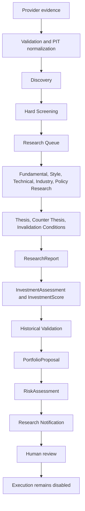
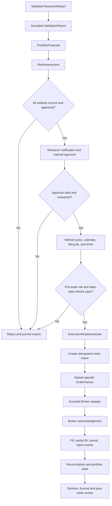

# Execution Readiness And Storyboard

## Current State

Execution is fail-closed. The repository contains disabled guard contracts and
placeholder execution types, but it does not contain an approved live execution
service. PIT readiness is `UNSUITABLE`, Portfolio is a research artifact, and no
Paper Trading, broker certification, or live-order approval exists.

## Remaining Gates

The following gates are sequential. Passing a later engineering test cannot
waive an earlier evidence gate.

1. **PIT data gate**
   - Complete the representative 84-day provider evidence horizon.
   - Reassess lifecycle, universe, fundamentals, corporate actions, and market
     inputs with reviewed trust, precision, continuity, and consistency.
   - Critical replay datasets must reach at least reviewed `CAUTION`; execution
     requires a stricter dataset-by-dataset policy than this minimum.
2. **Research-definition gate**
   - Freeze every indicator formula, warm-up, market rule, parameter, setup
     state, invalidation rule, and evidence hash.
   - Complete `WP-RESEARCH-001` without emitting execution actions.
3. **Historical validation gate**
   - Build PIT replay samples including delisted, ST, suspended, and missing
     observations.
   - Complete walk-forward, final out-of-sample, robustness, factor-ablation,
     regime, thesis, and decision-journal reviews.
4. **Portfolio and risk gate**
   - Require acceptable Validation status, not only a report identifier.
   - Convert risk budgets into actual weight constraints.
   - Add covariance, capacity, turnover, currency, fees, tax assumptions,
     round-lot rules, and gap/limit-down stress.
5. **Paper Trading architecture and implementation gate**
   - Approve a separate design first.
   - Build an isolated hypothetical ledger using the same decision contracts as
     future live execution.
   - Model calendars, T+1, price limits, suspensions, partial fills, cancels,
     fees, slippage, corporate actions, and stale quotes.
6. **Operational safety gate**
   - Add idempotent intent/order state machines, reconciliation, kill switch,
     exposure limits, rate limits, clock health, stale-data rejection, audit
     logs, metrics, incident runbooks, backup, and disaster recovery.
7. **Broker certification gate**
   - Certify QMT/PTrade separately for China A and IBKR/Moomoo separately for
     overseas markets.
   - Test sandbox or broker-provided simulation, rejected orders, disconnects,
     duplicate callbacks, partial fills, and recovery.
8. **Controlled rollout gate**
   - Shadow mode, then Paper Trading, then semi-automatic minimum capital with
     manual approval.
   - Fully automatic mode requires a separate explicit approval after measured
     operational performance and an independent architecture audit.

## Research-Only Storyboard Today

The current storyboard ends at human review. Notification is research
information only and has no dependency on Order, Broker, Trade, Fill, or
Execution.

## Future Semi-Automatic Storyboard

This flow is a target architecture, not an implemented capability:

Every transition is persistent, idempotent, timestamped, and explainable. A
timeout is not treated as a rejection or a fill until reconciliation proves the
state.

## Future Automatic Storyboard

Automatic mode reuses the same artifacts and state machine. It may remove the
per-order manual approval only for a separately approved strategy/version,
capital envelope, market, broker, time window, and risk policy. It still
requires:

- explicit live permission and a short-lived readiness authorization;
- current accepted Validation, Portfolio, and Risk artifacts;
- pre-trade and continuous risk limits;
- stale-data, exchange-calendar, suspension, and price-limit checks;
- global and strategy-specific kill switches;
- broker and internal position reconciliation;
- immutable decision and incident journals.

Automatic execution must fail closed when any required artifact, heartbeat,
quote, calendar, broker state, or reconciliation result is missing.

## Market-Specific Branches

### China A

- T+1 sellability and available-position checks;
- board-specific lot size and price-limit rules;
- ST and delisting-state checks;
- suspension, limit-up entry, and limit-down exit constraints;
- QMT and PTrade behavior certified independently.

### Overseas

- exchange calendars, time zones, currencies, and FX exposure;
- fractional-share policy, short-sale policy, and market/limit-order rules;
- corporate actions and withholding/tax assumptions;
- IBKR and Moomoo behavior certified independently.

Shared research logic must never embed one market's microstructure rules.

## Promotion Decision

Execution cannot be enabled by changing one configuration value. Promotion
requires measured evidence, a new approved work package, updated governance,
an architecture audit, full tests, operational runbooks, and Tong's explicit
approval. Until then, `execution.mode = "disabled"` and
`allow_live_orders = false` remain mandatory.
