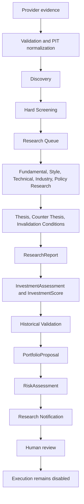
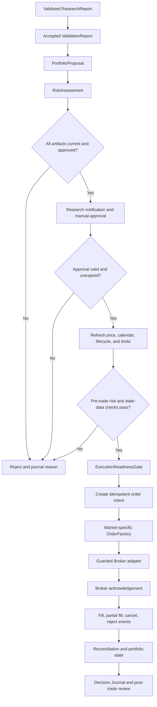

# Execution Readiness And Storyboard

## Current State

Execution is fail-closed. The repository contains disabled guard contracts and
placeholder execution types, but it does not contain an approved live execution
service. PIT readiness is `UNSUITABLE`, Portfolio is a research artifact, and no
Paper Trading, broker certification, or live-order approval exists.

Operator account availability is recorded only for future planning: a Moomoo
Malaysia account and a Guojin Securities China account are open. No account
identifier, credential, API permission, sandbox capability, market entitlement,
or broker behavior has been captured or certified. Account availability does
not satisfy any readiness gate and does not authorize integration work.

## Remaining Gates

The following gates are sequential. Passing a later engineering test cannot
waive an earlier evidence gate.

1. **PIT data gate**
   - Complete the representative 84-day provider evidence horizon.
   - Reassess lifecycle, universe, fundamentals, corporate actions, and market
     inputs with reviewed trust, precision, continuity, and consistency.
   - Reviewed `CAUTION` with verified consistency is a minimum to reconsider
     the development freeze, not permission to create ValidationRequests or
     enable execution. The current replay gate requires every declared dataset
     to be `USABLE` and ready for historical replay. Future execution needs a
     separately approved, stricter dataset-by-dataset policy.
2. **Research-definition gate**
   - Freeze every indicator formula, warm-up, market rule, parameter, setup
     state, invalidation rule, and evidence hash.
   - Complete `WP-RESEARCH-001` without emitting execution actions.
3. **Historical validation gate**
   - Build PIT replay samples including delisted, ST, suspended, and missing
     observations.
   - Complete walk-forward, final out-of-sample, robustness, factor-ablation,
     regime, thesis, and decision-journal reviews.
4. **Portfolio and risk gate**
   - Require an authenticated, current, acceptable Validation status, not only
     a report identifier. The current PortfolioCandidate stores a free-form
     `validation_status` but does not enforce it.
   - Convert risk budgets into actual weight constraints.
   - Add covariance, capacity, turnover, currency, fees, tax assumptions,
     round-lot rules, and gap/limit-down stress.
5. **Paper Trading architecture and implementation gate**
   - Approve a separate design first.
   - Build an isolated hypothetical ledger using the same decision contracts as
     future live execution.
   - Model calendars, T+1, price limits, suspensions, partial fills, cancels,
     fees, slippage, corporate actions, and stale quotes.
6. **Operational safety gate**
   - Add idempotent intent/order state machines, reconciliation, kill switch,
     exposure limits, rate limits, clock health, stale-data rejection, audit
     logs, metrics, incident runbooks, backup, and disaster recovery.
7. **Broker certification gate**
   - Select and certify each future China A adapter independently, including
     any approved Guojin Securities access path, and certify IBKR/Moomoo
     separately for overseas markets.
   - Test sandbox or broker-provided simulation, rejected orders, disconnects,
     duplicate callbacks, partial fills, and recovery.
   - Confirm API and market permissions with each broker; an open Moomoo or
     Guojin account is not evidence of programmatic-trading access. Review
     applicable exchange reporting requirements with the China broker.
8. **Controlled rollout gate**
   - Shadow mode, then Paper Trading, then semi-automatic minimum capital with
     manual approval.
   - Fully automatic mode requires a separate explicit approval after measured
     operational performance and an independent architecture audit.

## Concrete Engineering Gaps

- `ChinaAShareRules` still approximates T+1 as the next calendar day and uses
  one 5% ST / 10% non-ST price-limit rule without board or effective-date
  inputs. This is unsuitable for historical simulation or live risk checks;
  exchange rules must be versioned by venue, board, instrument, and date.
- Portfolio eligibility checks for an InvestmentScore and a nonempty
  ValidationReport ID, but does not check whether the corresponding report is
  accepted, current, or authentic. Proposed weights remain heuristic and are
  not capital-sizing instructions.
- `ExecutionReadinessGate` currently checks configured mode, booleans, an
  approved RiskDecision, and nonempty artifact/approval/token strings. It does
  not retrieve artifacts, bind identities and versions, verify freshness or
  authorization, or certify a broker. Its default remains disabled; the
  placeholder gate must not be treated as a production authorization system.
- No Paper Trading ledger, order-state machine, fill reconciliation, broker
  adapter, or operational kill switch exists. Account ownership and research
  notifications do not substitute for any of these controls.

The A-share rule drift is documented by the [SSE 2026 trading-rule notice](https://www.sse.com.cn/aboutus/mediacenter/hotandd/c/c_20260424_10816474.shtml)
and [SZSE 2026 trading rules](https://docs.static.szse.cn/www/lawrules/rule/trade/current/W020260424690713155663.pdf).
Historical tests must preserve the rules in force at each simulated date, not
apply today's limits to the past. Moomoo's [account-list API](https://openapi.moomoo.com/moomoo-api-doc/en/trade/get-acc-list.html)
exposes per-account market authority; no such account check has been made for
this project.

## Research-Only Storyboard Today

The current storyboard ends at human review. Notification is research
information only and has no dependency on Order, Broker, Trade, Fill, or
Execution.

## Future Semi-Automatic Storyboard

This flow is a target architecture, not an implemented capability:

Every transition is persistent, idempotent, timestamped, and explainable. A
timeout is not treated as a rejection or a fill until reconciliation proves the
state.

## Future Automatic Storyboard

Automatic mode reuses the same artifacts and state machine. It may remove the
per-order manual approval only for a separately approved strategy/version,
capital envelope, market, broker, time window, and risk policy. It still
requires:

- explicit live permission and a short-lived readiness authorization;
- current accepted Validation, Portfolio, and Risk artifacts;
- pre-trade and continuous risk limits;
- stale-data, exchange-calendar, suspension, and price-limit checks;
- global and strategy-specific kill switches;
- broker and internal position reconciliation;
- immutable decision and incident journals.

Automatic execution must fail closed when any required artifact, heartbeat,
quote, calendar, broker state, or reconciliation result is missing.

## Market-Specific Branches

### China A

- T+1 sellability and available-position checks;
- board-specific lot size and price-limit rules;
- ST and delisting-state checks;
- suspension, limit-up entry, and limit-down exit constraints;
- QMT and PTrade behavior certified independently.

### Overseas

- exchange calendars, time zones, currencies, and FX exposure;
- fractional-share policy, short-sale policy, and market/limit-order rules;
- corporate actions and withholding/tax assumptions;
- IBKR and Moomoo behavior certified independently.

Shared research logic must never embed one market's microstructure rules.

## Promotion Decision

Execution cannot be enabled by changing one configuration value. Promotion
requires measured evidence, a new approved work package, updated governance,
an architecture audit, full tests, operational runbooks, and Tong's explicit
approval. Until then, `execution.mode = "disabled"` and
`allow_live_orders = false` remain mandatory.
